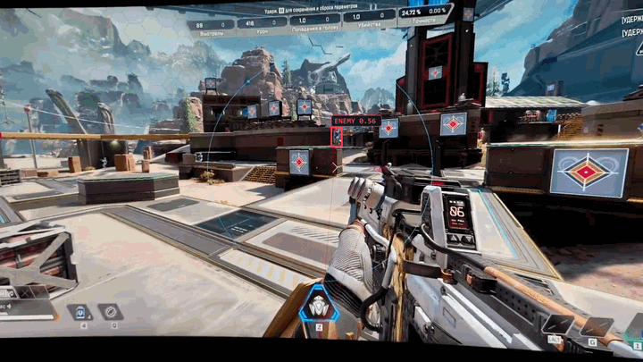
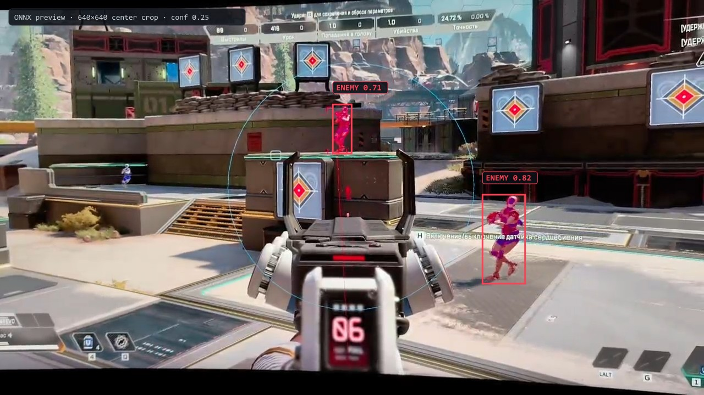
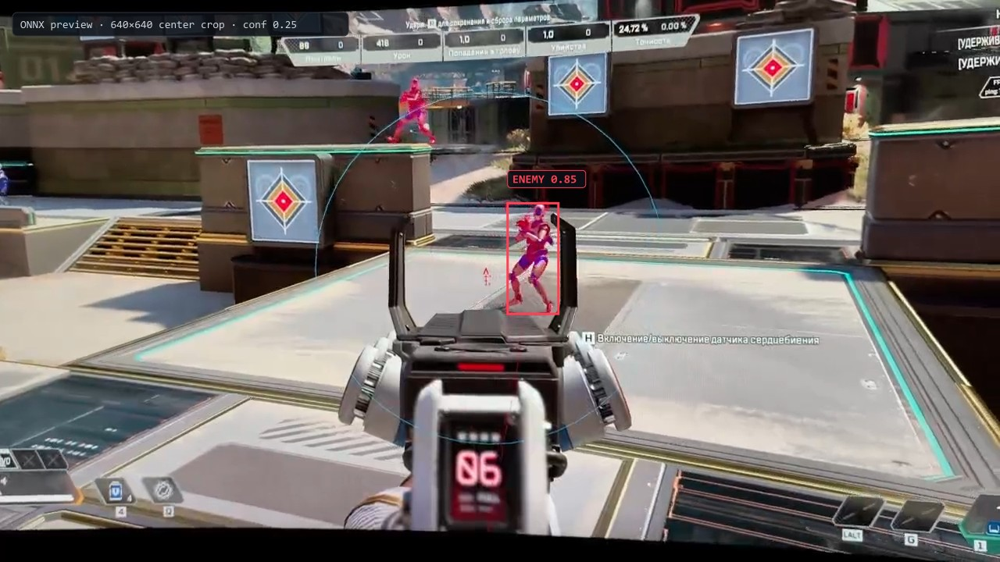
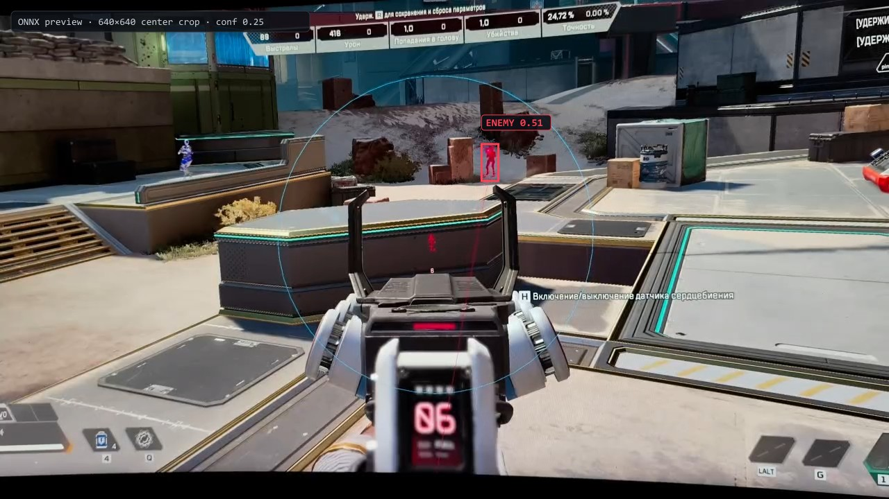

<div align="center">

# ML Enemy Detection

**Game-agnostic YOLO26n character detector + Rust / Direct3D 11 visual overlay.**  
Trained on Apex Legends footage; the pipeline can be fine-tuned for other games.


[▶ Watch the 50-second demo](docs/demo.mp4) · [Model preview](#model-preview) · [Model results](#model--results)

</div>

> [!WARNING]
> **Visual-only POC. Not an aimbot.**
> This repository contains screen capture, object detection and a transparent overlay only. It does **not** read game memory, inject into the game process, emulate mouse input or automate aim. Using visual overlays or ESP in online games violates EA's Terms of Service and can result in an account ban. The demo was recorded in the **Firing Range**. Do not use this in live matches.

> **По-русски:** POC детектора персонажей: YOLO26n + ONNX + Rust/D3D11. Обучен на Apex Legends, пайплайн переносится и на другие игры. Только визуальный слой, без аима и ввода. Не для онлайн-игры.

---

## What this is

An ML enemy/teammate detector with a separate, click-through Direct3D 11 overlay.

The model was trained on **Apex Legends** Firing Range footage and detects two classes: `Enemy` and `Friendly`. The training/inference pipeline is **game-agnostic**, but zero-shot performance on other games is not benchmarked — a different art style or camera setup normally needs fine-tuning on frames from that game.

The aim part was **intentionally not built**: it would require a hardware mouse-emulation board, a capture card and a two-PC setup. This repository stops at the visual layer.

| Part | Status |
| --- | --- |
| Screen capture + preprocessing | Working: Windows Graphics Capture (WGC) + GDI BitBlt fallback |
| YOLO26n detection | Working: 2 classes, FP16 ONNX, TensorRT / CUDA / DirectML / CPU providers |
| Tracking + smoothing | Working: IoU association, velocity lead and visual smoothing |
| D3D11 overlay | Working: click-through transparent window, box/head-dot/snapline/HUD/FOV rendering |
| Training + ONNX export | Working: reproducible Python pipeline and validation metrics |
| Game-agnostic reuse | Possible, but requires fine-tuning/validation per game |
| Aim / mouse input | **Not implemented** — no input injection, no game memory access |
| Anti-cheat bypass | **Not implemented and not supported** |

## Demo

<p align="center">
  <a href="docs/demo.mp4">
    
  </a>
</p>

<p align="center"><sub>Model predictions on demo footage · 720×405 · click the GIF for the full 50-second video</sub></p>

> The GIF is an **offline visualisation**: the included ONNX model was run on frames from the demo and the real boxes/confidences were drawn on top. The runtime overlay is a separate D3D11 layer and is not the same thing as this preview. The demo footage is from Apex Legends, the training domain.

### Model preview

| Two detections — 12.4 s | Close target — 16.0 s |
| --- | --- |
|  |  |
| One near target (`0.82`) and one far target (`0.71`) | A single close target (`0.85`) |

<p align="center">
  
</p>

<p align="center"><sub>Offline ONNX inference · 640×640 center crop · confidence threshold 0.25 · frames from the demo</sub></p>

## Features

- **Capture:** Windows Graphics Capture (WGC) with GDI BitBlt fallback; center 640×640 crop.
- **Detection:** YOLO26n, 2 classes (`Enemy`, `Friendly`), 640×640 input, FP16 ONNX.
- **Providers:** TensorRT → CUDA → DirectML → CPU fallback. The active provider is selectable in the UI.
- **Tracking:** IoU association, smoothing, short-horizon velocity lead and snapline rendering.
- **Overlay:** transparent, topmost, click-through D3D11 window with no game-process injection.
- **Visual presets:** `Default`, `Precise`, `HighRecall` (all are **visual** presets; they change colors/box type/confidence, not aim).
- **UI:** model/config pickers, confidence/IoU thresholds, FOV circle, HUD, FPS/latency counters.
- **Training:** Ultralytics YOLO training, validation metrics, ONNX export copied into the Rust runtime.
- **Tests:** 17 Rust test files covering capture, model loading, tracking, overlay and E2E paths.

> **No pose estimation.** The detector returns 2D boxes, not keypoints. Skeleton/keypoint toggles in the configs are UI/template features, not learned pose output. Health and distance labels are cosmetic placeholders; the project does not read game state.

## Architecture

```text
Game window
        │
        ▼
┌──────────────────────────────────────────────┐
│ Capture                                      │
│ WGC / GDI BitBlt                             │
│ center 640×640 crop                          │
└──────────────────────┬───────────────────────┘
                       ▼
┌──────────────────────────────────────────────┐
│ YOLO26n ONNX (FP16)                          │
│ ultralytics-inference + ort                  │
│ TensorRT / CUDA / DirectML / CPU             │
└──────────────────────┬───────────────────────┘
                       ▼
┌──────────────────────────────────────────────┐
│ Tracking + smoothing                         │
│ IoU association, EMA, velocity lead          │
└──────────────────────┬───────────────────────┘
                       ▼
┌──────────────────────────────────────────────┐
│ D3D11 click-through overlay                  │
│ corner/2D/filled boxes, head dot, snapline,  │
│ HUD, FOV circle                              │
└──────────────────────────────────────────────┘
```

The overlay is a separate window rendered on top of the desktop. It does not touch the game process, does not read game memory and does not send input.

## Model & results

| Item | Value |
| --- | --- |
| Base model | `yolo26n.pt` (downloaded automatically if missing) |
| Input | 640 × 640 |
| Classes | 2 — `Enemy`, `Friendly` |
| Training images | 48,490 (Apex Legends) |
| Validation images | 5,314 (Apex Legends) |
| Test images | 840 (not used for tuning) |
| Boxes | 55,348 enemy · 956 friendly |
| Epochs | 30 |
| Batch | 32 |
| GPU | RTX 4070 Ti, CUDA 12.1, AMP off |
| Train time | 11,157 s (~3.1 h) |
| Best weights | 5.14 MB (`best.pt`) |
| Runtime ONNX | 4.73 MB (`enemy_detector.onnx`) |

**Validation metrics at epoch 30** (from `train_python/runs/apex_yolo/results.csv`):

| Precision | Recall | mAP@50 | mAP@50–95 |
| ---: | ---: | ---: | ---: |
| 0.848 | 0.821 | 0.846 | 0.485 |

> The friendly class is heavily underrepresented (956 boxes vs 55,348 enemy boxes). Enemy detection is the strong part; friendly detection is experimental. These are validation metrics, not a benchmark in live matches or on other games.

## Repository layout

```text
ml-enemy-detection/
├── dataset/
│   └── README.md                  # dataset stats and re-export notes
├── train_python/
│   ├── train.py                   # YOLO26n training
│   ├── export_onnx.py             # best.pt -> enemy_detector.onnx -> rust_run/
│   ├── check_gpu.py
│   ├── requirements.txt
│   └── runs/apex_yolo/            # metrics, curves, best.pt
├── rust_run/
│   ├── src/                       # capture, native inference, overlay, UI
│   ├── configs/                   # Default / Precise / HighRecall
│   ├── tests/                     # 17 integration/unit test files
│   ├── vision_engine.py           # experimental GDI -> UDP Python prototype
│   ├── enemy_detector.onnx        # runtime model
│   └── vendor/procmod-overlay/    # vendored MIT overlay crate
├── docs/
│   ├── demo.gif                   # model-prediction GIF
│   ├── demo.mp4                   # 50-second demo footage
│   └── screenshots/
├── README.md
├── NOTICE.md
└── LICENSE
```

The **training dataset is not redistributed**: the original 4.1 GB Apex Legends image archive and its signed manifest/CDN URLs are not part of this repository. `dataset/README.md` documents the split and how to plug in your own export. `train.py` accepts a `DATASET` environment variable.

## Quick start

### 1. Train / export (optional)

Python 3.11 or 3.12 with a CUDA 12.1 PyTorch build is recommended.

```powershell
cd train_python
python -m venv .venv
.venv\Scripts\Activate.ps1
pip install torch torchvision --index-url https://download.pytorch.org/whl/cu121
pip install -r requirements.txt
python check_gpu.py
```

Export your own dataset manifest from the Ultralytics Platform and point `DATASET` at it:

```powershell
$env:DATASET = "C:\path\to\your-dataset.ndjson"
python train.py
python export_onnx.py
```

If `DATASET` is not set, `train.py` looks for `../apex-2.ndjson` next to the repository. `yolo26n.pt` is downloaded automatically if missing. Training uses 30 epochs at 640×640; adjust `batch`, `imgsz` and `workers` for your VRAM. `export_onnx.py` writes FP16 ONNX to `rust_run/enemy_detector.onnx`.

### 2. Run the overlay (Windows)

**Prerequisites:** Windows 10/11 x64, Rust stable, an ONNX Runtime DLL, and optionally an NVIDIA GPU with CUDA/cuDNN/TensorRT. The app can fall back to DirectML or CPU, but real-time performance will be lower.

```powershell
cd rust_run
$env:ORT_DYLIB_PATH = "C:\path\to\onnxruntime.dll"
$env:TENSORRT_DIR   = "C:\path\to\TensorRT-10.x"   # optional
cargo run --release
```

The app loads `enemy_detector.onnx` from `rust_run`, reads `configs/*.json`, and opens the overlay UI. Select a provider, model and config in the UI. The overlay is click-through; it does not capture or block the mouse.

If you do not have TensorRT, select **CUDA**, **DirectML**, or **CPU** in the UI. `onnxruntime.dll` must match the selected build (GPU vs CPU).

### 3. Experimental Python engine

`rust_run/vision_engine.py` is a standalone GDI + ultralytics prototype that captures a 640×640 center crop and streams JSON detections over UDP to `127.0.0.1:44555`. The current Rust app uses the native WGC/inference path and does **not** consume that UDP stream. Treat the Python engine as an experiment/reference implementation.

### 4. Tests

```powershell
cd rust_run
cargo test --release
```

Some tests expect a live game window, a GPU/TensorRT runtime or a specific display configuration. They are integration probes, not a CI suite; run them selectively.

## Config profiles

All profiles are **visual** presets, not aim modes.

| Profile | Enemy box | Confidence | FOV | Notes |
| --- | --- | ---: | ---: | --- |
| `Default.json` | Corner box | 0.50 | 420 | Balanced defaults |
| `Precise.json` | Corner box | 0.65 | 320 | Tighter FOV, fewer detections |
| `HighRecall.json` | Filled box | 0.40 | 640 | High-recall visual preset |

`enemy_skeleton` / `enemy_keypoints` flags exist in the config schema and UI, but the model is a detector, not a pose model. Do not expect learned keypoints.

## Limitations

- **Visual only.** No aim, no recoil control, no mouse/keyboard emulation, no game-memory access.
- **No anti-cheat bypass.** Not tested against EAC; do not use online.
- **Trained on Apex Legends.** The detector can be fine-tuned for other games, but zero-shot cross-game accuracy is not benchmarked.
- **2D boxes only.** No depth, occlusion reasoning or health/distance from the game; those labels are cosmetic.
- **Class imbalance.** Friendly boxes are rare (956 vs 55,348 enemy); friendly recall is weaker.
- **Windows + DLL setup.** TensorRT/CUDA/onnxruntime DLL versions must match; CPU fallback is slow.
- **No live-match benchmark.** The demo is in the Firing Range; real matches add smoke, effects and occlusion.
- **Not a product.** This is a POC; expect rough edges and hardware-specific tuning.

## Safety & ethics

This repository is an educational computer-vision and rendering experiment. It is **not** affiliated with EA, Respawn Entertainment or Apex Legends. Apex Legends and all related assets/trademarks belong to their respective owners.

Do not use this project in online matches. Visual overlays and ESP are against EA's Terms of Service and can result in bans. The repository intentionally contains no aim automation and no anti-cheat evasion.

## Credits

- [Ultralytics YOLO](https://github.com/ultralytics/ultralytics) — detector training/export.
- [procmod-overlay](https://crates.io/crates/procmod-overlay) — transparent overlay crate, vendored under `rust_run/vendor/procmod-overlay` (MIT).
- [windows-capture](https://crates.io/crates/windows-capture) — Windows Graphics Capture bindings.
- [ort](https://crates.io/crates/ort) and [ultralytics-inference](https://crates.io/crates/ultralytics-inference) — ONNX Runtime / TensorRT inference.
- [egui](https://github.com/emilk/egui) / eframe — UI.
- Demo footage and training data: Apex Legends Firing Range recordings; the raw dataset is not redistributed.

## License

MIT for the original code in this repository. Third-party components, model weights and game trademarks retain their own terms — see [NOTICE.md](NOTICE.md). No game models, textures or audio are included; demo/sample screenshots are documentation only, and the training dataset is not included.
